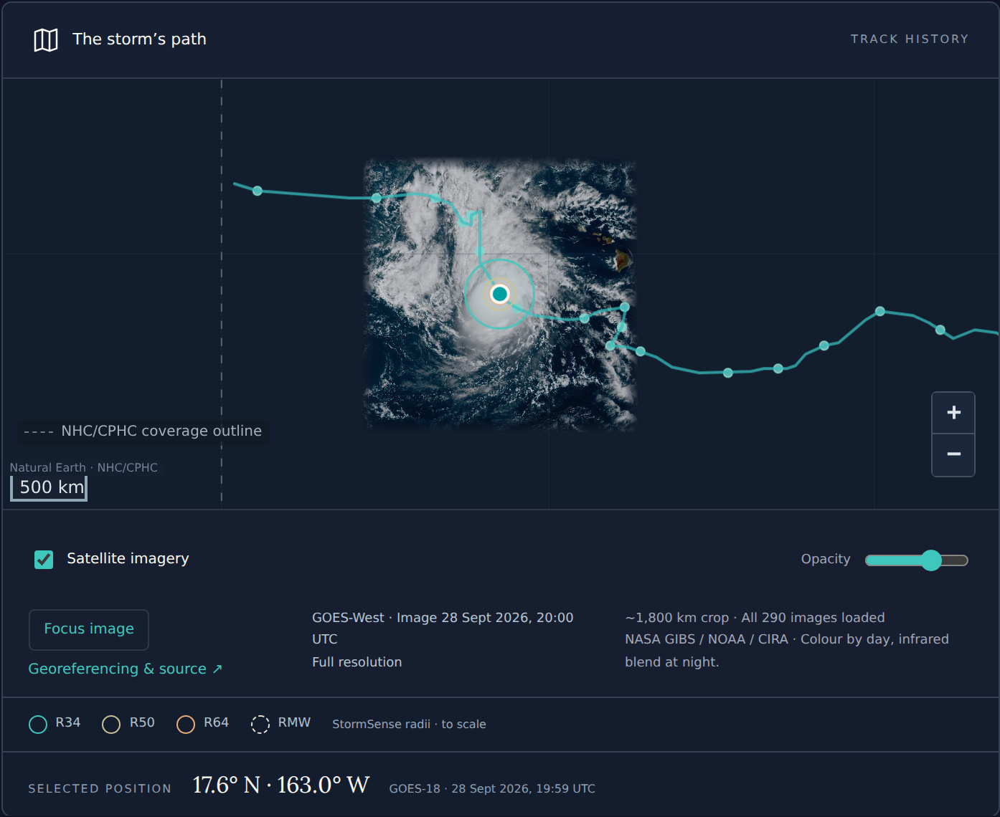
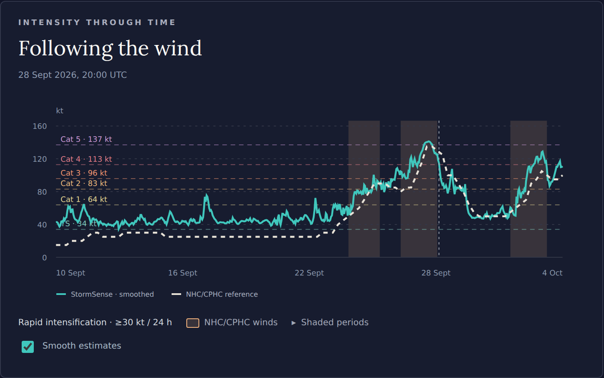

# geo2wf

Reconstruct tropical-cyclone surface wind fields and estimate maximum sustained
wind and wind radii from geostationary satellite imagery. geo2wf contains the
data loaders, PyTorch models, training and evaluation workflows for *Nowcasting
of Tropical Cyclone Wind Fields and Intensity from Geostationary Imagery*,
with results showcased in the StormSense application.

[Documentation](https://tcd.hyperalis.com/) ·
[Dataset on Hugging Face](https://huggingface.co/datasets/simon-donike/geo2wf-data) ·
[Models on Hugging Face](https://huggingface.co/simon-donike/geo2wf-models) ·
[Model guide](docs/models/index.md) ·
[StormSense](https://stormsense.hyperalislabs.com/)

Field U-Nets learn from sparse SAR wind retrievals; joint models also predict
intensity and radii through a shared encoder and latent MLP. ERA5 is optional
context, and SAR is supervision rather than an inference input. A separate
scalar model predicts six-hour intensity change, with a recursive twelve-hour
forecast.

## Explore StormSense

[StormSense](https://stormsense.hyperalislabs.com/) shows active and archived
NHC/CPHC storms in the Atlantic, eastern Pacific, and central Pacific. Explore
tracks, satellite imagery, hourly GEO-only intensity and wind-radius estimates,
and official reference winds. Historical hindcasts and estimates generated
during live updates are labeled separately. These are research estimates;
official guidance remains with NHC/CPHC.

[](https://stormsense.hyperalislabs.com/storms/EP152026?time=2026-09-28T20%3A00%3A00Z)

*Nolo on 28 September 2026 at 20:00 UTC: storm track, satellite image,
and model wind-radius rings.*

[](https://stormsense.hyperalislabs.com/storms/EP152026?time=2026-09-28T20%3A00%3A00Z)

*Nolo's intensity through time, including rapid-intensification periods.
The chart shows observation-time estimates; smoothing is a display option.*

See the [viewer guide](docs/explorer.md) for interpretation and the
[application guide](https://github.com/simon-donike/geo2wf/blob/main/apps/stormsense/README.md) for running the app and pipeline.

## Get started

Use Python 3.10 or 3.11:

```bash
uv sync --frozen
```

For the application repository's complete container workflow (CPU/GPU training,
inference, data downloads, website hosting and deployment), see the
[Docker guide](https://github.com/simon-donike/geo2wf/blob/main/apps/stormsense/runner/DOCKER.md).

## Download data and models

Both releases are public on Hugging Face; no login is required. The
[dataset](https://huggingface.co/datasets/simon-donike/geo2wf-data) contains
about **32.9 GB of scientific assets**, plus catalogs and reference results.
The [model release](https://huggingface.co/simon-donike/geo2wf-models) includes
**21 checkpoints (1.27 GB)**, configurations, provenance, and matching source code.
These binaries are stored separately from Git.

From this repository's root, install the download CLI and start with metadata:

```bash
uv tool install huggingface_hub
uv run python scripts/download_artifacts.py                 # Small metadata download
uv run python scripts/download_artifacts.py all --dry-run   # Preview full download sizes
uv run python scripts/download_artifacts.py all             # Download data and models
```

Use `data` or `models` instead of `all` to download only one release. Files go
to `downloads/data/` and `downloads/models/`; change the parent with
`--output-dir /path/to/storage`. Rerun the same command after an interruption;
the Hub client reuses completed downloads. The script pins matching immutable
data/model commits.

## Reproducibility

Use the pinned data/model revisions with each checkpoint's original
configuration, normalization statistics, and cohort membership. The matching
released source archive is also available at
`downloads/models/code/conference-source.tar.gz`.
This repository includes catalog loaders and reproduction scripts; the
[reproduction guide](docs/reproduction.md) and
[download guide](docs/data/index.md#use-the-downloads) give the commands.
The [checkpoint registry](release/registry.json) records the exact models,
configurations, cohorts, and provenance. The paper's architecture test and
latent-ablation validation cohorts differ.

## Use a trained model

Run wind-field inference with a checkpoint and its matching configuration:

```bash
uv run geo2wf-infer deterministic-residual \
  --config /path/to/resolved-config.yaml \
  --checkpoint /path/to/model.ckpt \
  --stats /path/to/paired/stats.json \
  --data-root /path/to/source-archive \
  --manifest /path/to/observation_manifest.csv \
  --reference-root /path/to/reference-series \
  --ibtracs-file /path/to/ibtracs.ALL.list.v04r01.csv \
  --output-root inference/my-run
```

See the [command reference](docs/reference/commands.md) for required data inputs
and workflow-specific help. Scalar intensity correction and forecasting
are available through `geo2wf-infer intensity-correction` and
`geo2wf-infer intensity-forecast`.

## Train on your data

These commands use the current checkout and expect a
[local raster export](docs/data/dataset-contract.md), with split manifests and
the referenced rasters. The downloaded Hub catalog uses the
[catalog workflow](docs/data/huggingface.md).

```bash
WANDB_DISABLED=true uv run geo2wf-train \
  data=geo_sar_common10_era5 \
  model=deterministic_residual \
  data.root=/path/to/geo_sar \
  data.stats_file=/path/to/geo_sar/stats.json
```

The [first experiment](docs/getting-started/first-experiment.md) walks through
loading a batch and running a small training job. [Model presets](docs/models/index.md#training-presets)
cover field U-Nets, joint field/intensity models, and scalar heads.

## Repository

```text
src/geo2wf/       data loaders, models, training, inference, and metrics
configs/         data and model presets
scripts/         data preparation, inference, evaluation, and reproduction workflows
release/         checkpoint registry, publication tables, and provenance
docs/            usage guides, model descriptions, paper results, and legacy assets
tests/           data, model, and integration checks
```

For development:

```bash
uv sync --frozen --group dev --group docs
uv run python -m pytest
uv run geo2wf-evaluate conference tables
```
